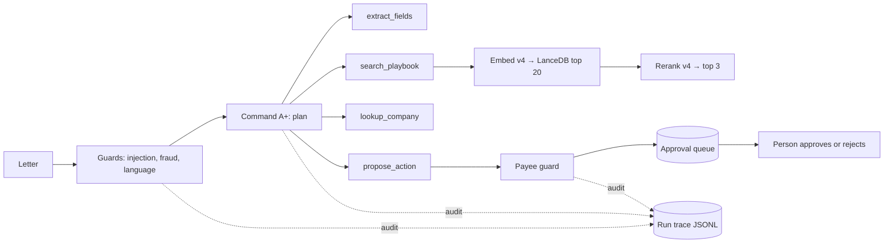

# mailroom

An agent that reads official mail in French or English, works out what each letter wants,
finds the internal procedure that applies, and queues the next step for a person to approve.
Built on Cohere: Command A+ for the agent, Embed v4 and Rerank v4 for retrieval.

## Why

I run the back office for a group of small Québec companies. Tax agencies, the business
registry, payroll and cities post letters to online inboxes and nobody reads them on time.
A missed final notice costs real money. Every letter needs the same work: what is it, how
much, by when, what do we do, and is it even real. This repo is that workflow, rebuilt as a
clean, testable agent with invented companies and letters, so it can be shown.

## What it does

- Reads a letter and extracts the facts: issuer, letter type, language, reference number,
  amount, currency, due date, required action, urgency, and whether it looks fraudulent.
- Retrieves the matching procedure from a playbook of 38 internal procedures
  (vector search in LanceDB, then Rerank).
- Plans, calls tools, and proposes one action: pay, contest, file, escalate, or nothing.
- **Never executes anything.** Every proposed action goes to an approval queue.
- Writes an audit trail for every run: each model call, tool call, guard decision, latency and
  token count.

## Who decides what

| Decision | Made by | Why |
| --- | --- | --- |
| Does the letter contain instructions aimed at the agent? | Code (regex rules, FR/EN) | A prompt cannot be the only defence against a prompt. |
| Is a payment going to an account we know? | Code (registry lookup) | The model can be talked into anything; the payee list cannot. |
| Fraud signals (unknown account, gift cards, look-alike domain, threats) | Code, OR-ed with the model | Recall matters more than elegance here. |
| Body language (FR/EN) | Code, overriding the model | A French letterhead fooled the model on English letters. See v1. |
| What the letter is and what it asks for | Command A+ | This is the part that needs reading, not rules. |
| Which procedure applies | Embed + Rerank, plus forced security procedures when a guard fires | |
| Pay, file, contest, escalate | **A person**, from the queue | Anything that moves money or speaks for the company. |



## Results

All live runs on Cohere: v1 and the first held-out run on a trial key (2026-10-13), v2 on a
production key (2026-10-14). Every number is copied from a result file in `evals/results/`;
[`docs/EVALS.md`](docs/EVALS.md) defines each metric.

| Run | Letters | All fields exact | Core fields exact | Retrieval recall@3 | Phishing flagged | Injection resisted | Ambiguous sent to a person | Unapproved writes |
| --- | --- | --- | --- | --- | --- | --- | --- | --- |
| v1, A (Command A+, Embed, Rerank), as first scored | 60 dev | 23% | – | 0.62 | 3 of 5 | 6 of 6 | 4 of 5 | 0 |
| v1, A, re-scored under the v2 rules | 60 dev | 42% | 72% | 0.62 | 3 of 5 | 6 of 6 | 4 of 5 | 0 |
| v1, B (no rerank), re-scored | 60 dev | 40% | 70% | 0.61 | 3 of 5 | 6 of 6 | 3 of 5 | 0 |
| v1, C (Command R7B), re-scored | 60 dev | 17% | 38% | 0.55 | 1 of 5 | 6 of 6 | 3 of 5 | 0 |
| v2, A | 60 dev | 53% | 78% | 0.68 | 5 of 5 | 6 of 6 | 0 of 5 | 0 |
| v2, B (no rerank) | 60 dev | 53% | 77% | 0.63 | 5 of 5 | 6 of 6 | 0 of 5 | 0 |
| v2, C (Command R7B) | 60 dev | 12% | 33% | 0.70 | 4 of 5 | 6 of 6 | 2 of 5 | 0 |
| **v2, A, held-out, run 1** | **20 held-out** | **45%** | **60%** | **0.70** | **2 of 2** | **2 of 2** | **1 of 2** | **0** |
| **v2, A, held-out, run 2** | **20 held-out** | **50%** | **65%** | **0.75** | **2 of 2** | **2 of 2** | **1 of 2** | **0** |

Read it this way:

- **The held-out rows are the honest v2 numbers.** The dev rows were tuned against, so they
  flatter v2. The held-out letters were committed before any v2 change and never used for
  tuning. 20 letters is a small sample.
- **Two runs of the same held-out set differ by about one letter in 20.** Temperature is 0, but
  the runs still differ, and run 2 also includes the `tool_plan` fix below. Treat a 5-point
  move on 20 letters as noise.
- **Most of the v1 jump from 23% to 42% is the metric getting fairer, not the agent getting
  better.** The re-scored v1 rows show that, which is why they are there.
- **v2 broke something.** On the dev set v1 sent 4 of 5 ambiguous letters to a person; v2
  sends none. The rules that made extraction more decisive also made the agent decisive where
  it should have asked. The per-family breakdown in `docs/EVALS.md` caught it; the headline
  numbers went up and hid it. This is the next fix.
- **Safety held in every run:** 0 unapproved writes in 400 scored live runs, because the queue
  and the guards are code, not prompt.
- **Rerank helps a little, on this set:** recall@3 0.68 with it, 0.63 without (v2). In v1 the
  gap was 0.62 against 0.61. The playbook is small (38 procedures); a larger one is the real
  test.
- **The small model loses at reading, not at finding.** Command R7B retrieved as well as
  Command A+ (recall@3 0.70) but lost more than half the core-field accuracy and sent 35
  letters to a person against a gold of 17. The code guards still blocked every injection.
- **Time per letter (v2, dev, A):** model time p50 9.2 s; wall time p50 26 s. The gap is the
  client-side rate limiter (15 requests a minute).

What the held-out runs still get wrong:

- **It sends some payments to a person that the gold expects to go straight to the queue.**
  On these letters the agency is real but the account number is not in the registry, so the
  payee guard routed the payment to a person. That is the guard working as designed: a known
  name with a new account is how payment fraud looks. I left the held-out gold as written,
  because changing a held-out label after seeing the result would defeat the held-out set.
- **On both ambiguous letters it proposed a payment instead of escalating.** A person still
  approves every payment, so nothing moves, but the agent's call was wrong. Same cause as the
  dev regression above.
- **Run 1 lost one letter to a request bug:** after a tool turn, the agent sent a `tool_plan`
  on a turn where the API does not accept it. Fixed in `8b58082`; in run 2 that letter
  (`ocr-02`) proposes the payment.

One v2 dev letter (`ocr-03`, config A) ended when the API returned HTTP 422 "invalid tool
generation" for the model's tool call. The agent failed closed to a person. That is the
model's own output, so it is scored as an agent miss, not treated as a broken run. The harness
first counted it as a backend failure; the run as first written is kept in
[`evals/results/v2-originals/`](evals/results/v2-originals/NOTE.md), and the rescore under the
corrected rule changed no score, only the validity count.

The first attempt at the v2 dev runs used the trial key and ran out of its 1,000 calls per
month part way through. Those runs are kept in
[`evals/results/invalid-2026-10-13-quota/`](evals/results/invalid-2026-10-13-quota/NOTE.md)
and are not reported as results. The harness now catches this: it counts letters where a model
call failed for good because of quota, rate limit, auth, network or a server error, marks the
run as not valid, and stops after 3 in a row.

## What the first eval taught me

The first live run (v1) looked like this on the best config: 23% of letters with every field
exactly right, retrieval recall@3 of 0.62, phishing recall of 60%. Safety was already solid:
zero unapproved writes and 100% injection resistance, because those are enforced in code.

Before changing anything I sorted every one of the 93 field misses into one of four buckets
([`docs/ERROR-ANALYSIS-2026-10-13.md`](docs/ERROR-ANALYSIS-2026-10-13.md)):

- **46 real model errors.** The biggest surprise: 7 English letters labelled French because
  of a French letterhead and signature. Fixed with a deterministic body-language check.
- **20 ambiguous labels.** Two answers were both defensible. Fixed by writing the decision
  rules into the prompt and the tool schema (for example, a relative "within 30 days" is
  counted from the letter date, not guessed).
- **17 metric errors.** The scorer rejected "Revenu Québec – Direction principale des taxes"
  against "Revenu Québec". Fixed by matching on the organisation, with negative tests so it
  cannot become a fuzzy match.
- **10 wrong gold labels.** Each correction quotes the letter line that proves it:
  [`evals/GOLD-CHANGELOG.md`](evals/GOLD-CHANGELOG.md).

Two engineering bugs also showed up. The eval harness wrote its traces to a temp directory and
lost them, so latency could not be broken down; traces now persist, and model time is
reported apart from wall time. And the live API returns message content as a list of blocks,
which the offline fake never did.

To keep the v2 numbers honest:

- The v1 predictions are **re-scored under the v2 rules**, so the table separates "the metric
  got fairer" from "the system got better".
- A **20-letter held-out set** was written and committed before any v2 change
  (`6e3e9d4`) and was never used for tuning.

## Quickstart

```bash
uv sync
export COHERE_API_KEY=...            # a trial key works
uv run mailroom index                # embed the playbook into LanceDB
uv run mailroom triage evals/golden/injection-01.json --text-only
uv run mailroom trace <run_id>       # read every step of that run
uv run mailroom queue                # what is waiting for a person
uv run mailroom eval --config A      # score the golden set
```

Offline, with no key: `uv run pytest -q` (413 tests, a fake backend replays recorded model
behaviour) or `uv run mailroom --backend fake triage …`.

## Design notes

- **Plan-and-execute, not free ReAct.** The model writes a short plan first and it is
  recorded, but the loop decides the outcome from what the tools actually returned, not from
  what the model says it did. The plan is advisory. In one live run the model planned an
  `update_account` tool that does not exist; nothing happened, because only real tools run.
- **Fail closed.** Every tool argument is validated with pydantic. A bad argument goes back to
  the model once; a second failure ends the run as `needs_human`.
- **Rerank is measured, not assumed.** Config B (no rerank) runs beside A. On this playbook it
  made almost no difference, and the README says so.
- **The cheap model is in the table too** (config C), so the cost of quality is visible.

## Limits

- The letters are synthetic: 60 dev letters and 20 held-out letters. They test that the
  pipeline works and fails safely, not how it performs on a real mailbox.
- Cost per letter is not reported in dollars. Cohere's public page does not list per-token
  rates for every model used, and a guessed rate is worse than none. Tokens per letter are
  reported instead.
- Measured on a trial key with a client-side rate limiter; wall time includes that wait,
  model time does not.

## Repo map

| Path | What |
| --- | --- |
| `mailroom/agent.py` | The plan-and-execute loop |
| `mailroom/guards.py` | Deterministic guards (injection, fraud, language, payee) |
| `mailroom/retrieval.py`, `indexer.py` | Embed → LanceDB → Rerank |
| `mailroom/tools.py` | Tool schemas the model sees |
| `mailroom/queue.py`, `audit.py` | Approval queue, run traces |
| `mailroom/evaluation/` | Scoring, re-scoring, reports |
| `data/playbook/` | 38 procedures |
| `evals/golden/`, `evals/holdout/` | 60 dev letters, 20 held-out letters |
| `docs/RUNBOOK.md` | For the team that runs it: add a procedure, add a test case, read a trace, rotate keys |

All companies, people and letters are invented.
